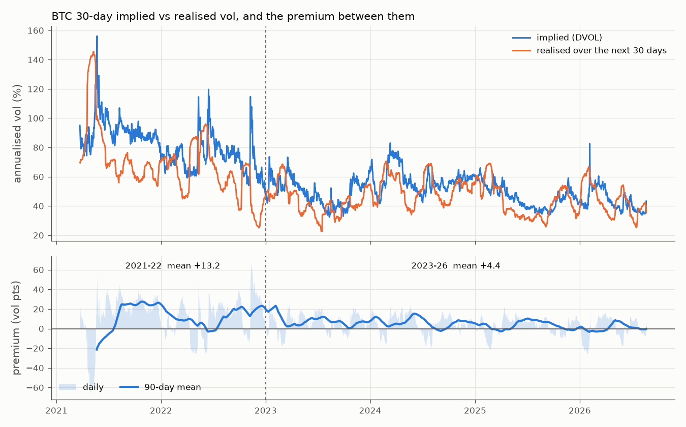
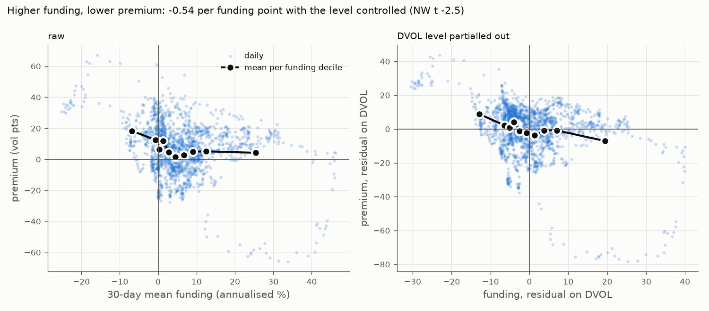
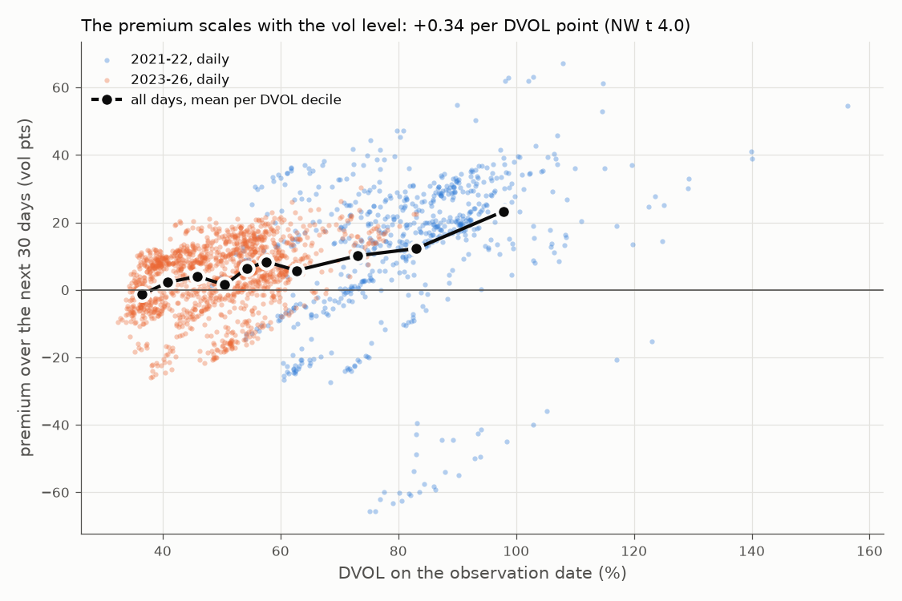
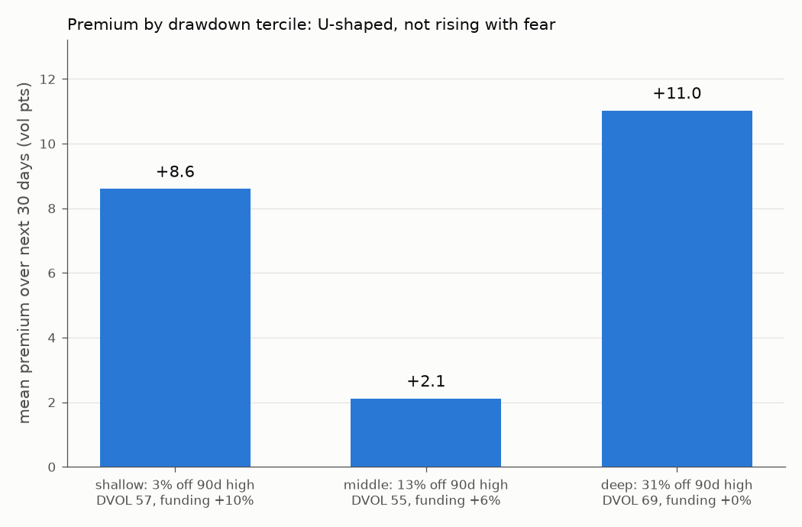

# Why is the premium going away? Hypotheses, written before testing

`README.md` reports that the BTC volatility risk premium (VRP) was capturable in
2021-22, absent since, and about the size of trading costs even when present.
This file proposes mechanisms for that and states, **before running any test**,
what each one predicts and what would count against it. The results section is
appended after the run, so the predictions cannot drift to fit the numbers.

Test code: `scripts/vrp_hypotheses.py`. Data: Deribit DVOL (daily implied, BTC
and ETH), hourly perpetual candles and funding, and the Tardis archive's
open interest. All already on disk except ETH DVOL, which is fetched once.

## Frame

For a delta-hedged option, P&L is roughly
`vega * (implied vol - realised vol) - option spread - hedge cost`. The
premium is the first term. Everything below is about why it is small, unstable,
or comparable to the other two.

## The hypotheses

**H0. Null: there is no stable premium.** The pooled mean is statistically
zero, one good sub-period is expected by chance given roughly 12 independent
months a year, and a regime split is an artefact of where the line was drawn.
Every other hypothesis has to beat this one.

**H1. Competition compressed it (supply side).** Growth of vol-selling capacity
(structured products, covered-call vaults, more market makers, regulated ETF
option flow) pushed implied toward realised.
- *Predicts:* a level shift in the premium that is localised in time, not a
  drift; the estimated break sits near a structural date.
- *Against:* no break distinguishable from noise, or a break that lines up with
  realised vol changing rather than implied vol changing.

**H2. 2021-22 was a leverage and demand shock.** Retail convexity demand bid
implied above realised; when leverage unwound the premium went with it.
- *Predicts:* premium correlates positively with perp funding (a leverage
  proxy) known at the observation date, and the relationship survives
  within era rather than only reflecting the era split.
- *Against:* funding has no predictive relation to the premium, or the sign is
  wrong.

**H3. The premium is jump compensation, and the sample did not pay it back
evenly.** Delta hedging cannot hedge gaps. Implied variance includes a
charge for jumps; a sample with few jumps looks like free money and a sample
with several looks like a loss.
- *Predicts:* implied variance exceeds forward **continuous** (bipower)
  variance by far more than it exceeds total realised variance; the jump
  component of realised variance is small on average and fat-tailed; windows
  with a high jump share are the ones where the premium is negative.
- *Against:* implied is roughly equal to continuous variance, i.e. there is
  nothing for jump compensation to explain.

**H4. Zero-profit equilibrium.** Dealers hedge the same gamma we do, so their
quoted implied must cover their own hedging cost. In a competitive market the
premium then equals the cost of harvesting it.
- *Predicts:* the average premium, converted to bps of spot for a 30-day ATM
  straddle, falls inside the measured cost range (about 11 bps option spread
  plus 20-75 bps hedge slippage from the sweep), and is not far above it.
- *Against:* premium far above or far below that range on average.

**H5. Insurance demand is concentrated in BTC, so ETH relative vol is
under-bid.** BTC option demand (hedgers, institutions) is deeper than ETH's, so
BTC carries more of the premium and ETH looks cheap against its own realised.
- *Predicts:* BTC VRP exceeds ETH VRP on average, also in relative terms
  (implied/realised), not just because BTC and ETH vol levels differ; the gap
  is larger on days where BTC holds a larger share of combined open interest.
- *Against:* ETH VRP is as large as BTC's, or the gap does not vary with the
  open-interest share.

## Known issues stated up front

- Windows are 30 days and overlap, so every t-statistic uses Newey-West with a
  30-day lag and every p-value a block bootstrap; both are reported next to a
  non-overlapping sample.
- The README's era numbers come from one-day straddle P&L; this study uses the
  30-day DVOL premium. They are different measures of the same premium and may
  not agree. Disagreement is itself a result.
- A break date is *estimated* from the same series it is tested on, so its
  p-value is from a sup-statistic bootstrap, not an ordinary t-test.
- Many tests are run here. Treat any single |t| near 2 as unconfirmed.
- ETH DVOL starts 2021-03, so H5 shares the BTC window.

---

# Results

Run: `python scripts/vrp_hypotheses.py` (about 25 s, offline once ETH DVOL is
cached). Every number below is from that run. The predictions above were
written first and are unedited.

## Verdicts

| | Hypothesis | Verdict | One-line reason |
|---|---|---|---|
| H0 | No stable premium | **Rejected** for "premium = 0"; **not rejected** for "constant mean" | t 4.8 pooled, 3.8 in 2023-26; but no break or trend test is significant on its own |
| H1 | Competition caused a level shift | **Not supported** | Estimated break 2022-12-30, bootstrap p 0.11-0.29; decline is gradual and disappears after controlling for vol level |
| H2 | Leverage demand raises the premium | **Contradicted** | Funding predicts the premium with the *opposite* sign (t -2.3; -2.8 within year; -2.5 with level control) |
| H3 | Premium is jump compensation | **Contradicted** on the discriminating test | High-jump windows have the *highest* premium (+11.0 vs +1.4); jump share is the same in both eras (11.8% vs 11.4%) |
| H4 | Premium is about the cost of harvesting it | **Supported, at 30 days, for 2023-26** | ATM straddle +83 bps gross vs a 31-86 bps cost range; not at 7 days (+13), not in 2021-22 (+180) |
| H5 | BTC premium exceeds ETH premium | **Supported as an association** | Level-free gap t 4.7, both eras, 5 of 6 years; OI-share link holds within every year; reverses in 2026 |

## What the data says, hypothesis by hypothesis

**Baseline.** BTC 30-day DVOL premium, hourly realised variance, 1,977 days:
implied 60.2, realised 53.0, premium **+7.25 vol points, NW t 4.8**, positive
73% of days. By year: +14.5, +12.1, +6.5, +5.8, +3.4, **+0.3** (2021 to 2026).

**H0 / H1.**
- The premium is not zero. 2023-26 alone is +4.36, 95% block-bootstrap
  interval [+2.1, +6.5].
- The 2021-22 vs 2023-26 gap is 8.8 vol points, but the estimated break
  (2022-12-30, sup|t| 2.91) has bootstrap p-values of **0.11, 0.21, 0.29** for
  30/90/180-day blocks. A constant mean is not rejected: with a premium this
  persistent, six years do not contain enough independent regimes to call the
  decline a break.
- At the pre-specified dates the before/after difference is significant for
  the ETF listing (t 2.57) and IBIT options (t 2.31) but not Terra (1.22) or
  FTX (1.91). That is not evidence for an ETF effect: **any steady decline
  produces a significant before/after gap at every interior date**.
- The decline looks like a drift: -2.44 vol points a year (t -2.09).

**H2 (contradicted).** I predicted funding, a leverage proxy, would be
positively related to the premium. It is negative: -0.49 per point of
annualised funding (t -2.25), -0.67 within year (t -2.83), -0.54 with DVOL
level controlled (t -2.50). On a non-overlapping sample it weakens to t -1.78.
So the premium is *higher when leverage is low or negative*, i.e. after
de-leveraging and fear, not in leveraged bull phases. The leverage-call-demand
story is wrong as stated.

**H3 (contradicted).** Implied variance exceeds the continuous (bipower)
component by 10.2 vol points against 6.9 for total realised, but that part is
mechanical whenever any jump variance exists (it is 11.6% of realised). The
discriminating prediction fails: windows ranked by their own jump share give
premiums of +1.4 / +9.3 / +11.0, and jump share stays a positive predictor
with vol level controlled (t 4.2). **I do not have an explanation for that
sign.** Candidate reasons (bipower is biased in volatile windows; high-jump
windows follow fear that has already lifted implied) are untested. What is
safe to say is that jumps do not explain the decline, because the jump share
did not change.

**H4 (supported, with a correction).**
- My first conversion of the DVOL premium to bps overstates what a straddle
  can collect. DVOL is a variance-swap-style index that prices the whole
  smile. On the 65 archive days where both exist it sits **4.2 vol points
  above ATM implied**, so the same-day premium is +6.4 against DVOL but only
  **+2.3 against ATM**. Roughly two thirds of the headline premium is smile
  convexity that an ATM position does not earn.
- Measured on the instrument itself (delta-hedged ATM straddle, mid, 4-hour
  hedge): 30-day **+83 bps in 2023-26 (t 2.4)** against costs of 31-86 bps.
  That is the top of the range, i.e. roughly break-even. In 2021-22 it was
  +180, well above cost.
- At 7 days the 2023-26 figure is +13 bps (t 0.4), below the cheapest cost
  case.
- So the picture is **disequilibrium in 2021-22 converging to roughly the cost
  of harvesting it**, which is what a zero-profit story predicts. It does not
  prove it: a small premium is also what "there is just not much here" looks
  like. Telling them apart needs the premium to track measured dealer costs
  over time, which this data cannot do.

**H5 (supported as an association).**
- BTC premium minus ETH premium is +2.64 vol points (t 2.5). In the
  level-free form, log(implied/realised) for BTC minus ETH is +0.058
  (**t 4.7**), positive in both eras (4.2, 3.2) and in 5 of 6 years.
- The README's narrow-spread result replicates on an independent source (daily
  DVOL, 1,977 days, against 77 monthly fitted surfaces): narrow spread +4.68
  (t 4.3), wide -0.12 (t -0.1). The cut uses an expanding median, so there is
  no lookahead.
- Mechanism: against BTC's share of combined option open interest, the gap
  rises *within every year* (within-year Spearman 0.82, 0.64, 0.77, 0.14,
  0.50, 0.17), pooled 0.52, and the slope is stable to dropping any one year
  (+76 to +132). The pooled raw slope is much weaker (+21, t 2.2) because
  BTC's share trends up over time (correlation +0.76).
- Against it: **2026 reverses** (gap -2.35, ratio gap t -3.0) at the highest BTC
  share of the sample (87%), so the level relationship does not hold across
  years. And OI share is an equilibrium outcome, not an independent cause.

## Post-hoc findings

These came from reading the results, not from the pre-written predictions,
and carry less weight.

1. **The premium depends on how realised variance is sampled**, by 3-6 vol
   points in a given year (2021: 14.5 at 1h, 12.1 at 4h, 19.0 at 24h; 2026:
   0.3, 1.6, 0.0). The era decline is robust to it (2021-22 to 2023-26: 13.2 to
   4.4, 11.7 to 4.7, 15.3 to 5.3). This is why the earlier close-to-close
   study reported 18.6 and 2.9 for 2021 and 2026 where this one reports 14.5
   and 0.3. Neither is wrong; they measure different hedge frequencies.
2. **The decline is mostly the vol level falling.** Implied vol moved from 81.5
   to 49.9 between eras. Regressing the premium on time gives -2.44 a year;
   adding the DVOL level flips time to +1.88 (t 1.4) and gives the level +0.46
   (t 5.2). The level slope is the other side of the fact that realised vol
   moves only 0.66 for each point of DVOL (t vs 1: -4.0): **implied vol
   over-reacts to its own level, so a high-vol regime carries more premium**.
   As a share of implied the premium went 15.0%, 15.1%, 11.8%, 9.1%, 7.5%,
   -1.1% by year; the proportional trend is borderline (t -1.9).

   

## What this changes about the story

1. **The README's "no premium pooled over six years" is a one-day statement.**
   At 30 days the premium is strongly positive and survives in 2023-26. The
   README's own numbers say so (+83 bps ATM, t 2.4), but the sentence about
   2021-22 being the only capturable era reads as if it covered the 30-day
   trade. It does not, and the wording should be tightened.
2. **A revised, still-untested story** fits all of the above: the premium is a
   fear / downside-hedging premium that scales with the vol level, is largest
   after de-leveraging, sits partly in the wings, and in the ATM straddle has
   converged to about the cost of harvesting it. Competition and leverage
   demand, the two mechanisms proposed first, are not what the data points to.
3. **The honest limit is sample size.** Roughly five independent monthly-scale
   regimes a year cannot tell a break from a persistent drift (H1), and the
   tests here (about 60 numbers) are numerous enough that a lone |t| near 2
   should not be trusted.

## Not tested, and what would test it

- **Whether the premium tracks dealer cost.** Needs a time series of measured
  bid-ask and hedge cost by year, not one cost range.
- **Why high-jump windows earn more (H3).** Use a jump estimator robust to
  volatility clustering (threshold bipower or realised semivariance).
- **Fear vs leverage (H2).** Replace funding with a direct fear proxy
  (put-call skew, or drawdown from the 90-day high) and see which wins.
- **Whether OI share causes the BTC/ETH gap (H5).** Needs an event where one
  asset's option demand shifts for a reason unrelated to its volatility; ETH
  around the Merge (2022-09) is the obvious candidate, and 2022 is where the
  BTC share is lowest.
- **2026.** The premium is about zero in the last eight months. Whether that
  is the start of something or noise is not knowable yet.

---

# Follow-up: fear or leverage? (H6), written before testing

H2 found funding predicts the premium with the *wrong* sign: the premium is
higher when leverage is low. The revised story above reads that as a fear
premium. This section tests that directly, with predictions fixed before the
code was run. Results are appended below them.

**H6. The premium is a fear premium, and funding's negative sign was standing
in for fear.** After drawdowns, demand for downside protection bids implied
above what is then realised, and funding is low or negative in the same
windows. So a direct fear measure should carry the relationship that funding
only proxied.

Two fear proxies, both known at the observation date:

- **90-day drawdown** of BTC from its trailing 90-day high (daily, perp
  closes). Daily sample, same as H2.
- **Put-call skew**: 30-day implied vol at standardised moneyness z = -1
  minus z = +1 (vol points), from the fitted surfaces in `vrp_surface.parquet`.
  Only the monthly archive days have it, and only where both wings sit inside
  the quoted strike range.

- *Predicts:*
  1. Deeper drawdown predicts a **higher** premium: positive slope, NW t > 2,
     also within year and with DVOL level controlled.
  2. Steeper put skew predicts a higher premium on the monthly sample, same
     sign. Because DVOL itself prices the wings, skew is mechanically tied to
     the DVOL premium, so the prediction must also hold for the **ATM**
     premium (30d ATM implied minus realised) on the same days.
  3. Horse race: with drawdown and funding in one regression (plus DVOL
     level), drawdown keeps its sign and significance and funding's slope
     shrinks toward zero, i.e. loses at least half of its size.
- *Against:* fear proxies have no relation or the wrong sign; or funding stays
  as large and significant with drawdown in the regression (then funding is
  measuring something other than fear); or skew only predicts the DVOL premium
  and not the ATM premium (then the link is mechanical, not demand).

Known issues, stated up front:

- Drawdown and funding are correlated by construction (crashes deleverage),
  so the horse race is the test, not either regression alone.
- The skew sample is about 65 monthly points. With monthly 30-day windows the
  observations barely overlap, so a lag-1 Newey-West is used, and power is low:
  a true effect may well show |t| under 2. That counts as "not supported",
  not as evidence against.
- This is one more batch of tests on top of about 60. A lone |t| near 2 is
  still not confirmation.

## H6 results

Run: same command, section `H6`. The predictions above were committed
(`d5fc7b9`) before this code existed.

**Verdict: contradicted.** All three predictions fail, and the third fails in
the direction the "against" clause named: funding gets *stronger* once
drawdown is in the regression, so whatever funding measures, it is not fear.

| | Prediction | Result |
|---|---|---|
| 1 | Deeper drawdown, higher premium, survives level control | Alone +0.17 per point (t 2.0); with DVOL level **-0.05 (t -0.5)**. All of it was the vol level |
| 2 | Steeper put skew, higher premium, also on ATM | DVOL premium +0.58 (t 2.0) alone, +0.27 (t 0.9) with level. ATM premium **+0.27 (t 1.0)**, with level +0.02 (t 0.1). n=64 |
| 3 | Funding shrinks by half with drawdown in | Funding goes from -0.54 (t -2.5) to **-0.79 (t -3.5)**; -0.84 (t -4.0) within year; -0.91 (t -2.9) non-overlapping |

What the numbers say:

- **Drawdown has no effect of its own on the premium.** Its raw link is the
  vol level: drawdowns come with high DVOL (correlation +0.43), and the level
  already predicts the premium (the post-hoc finding above). Conditional on
  level *and* funding, drawdown turns negative (-0.36, t -4.0). That sign is
  partly collinearity (drawdown and funding correlate -0.44), so I would not
  read it as "fear lowers the premium", only as "fear does not raise it".
- **The pattern across drawdown is U-shaped, not rising.** Terciles: shallow
  (2.8% off the high) +8.6, middle (13%) +2.1, deep (31%) +11.0. The deep
  tercile also has the highest DVOL (69 against 55-57), so it is the level
  again. Near highs, with funding at +10%, the premium is just as large.

  
- **Skew carries nothing for the trade you can actually do.** It predicts the
  DVOL premium only as far as it tracks the level, and does not predict the ATM
  premium at all. That is the mechanical case the predictions warned about:
  DVOL prices the wings, so a steeper skew lifts DVOL but not the ATM leg.
  Power is low (n=64), so this is "not supported" more than "disproved", but
  the point estimate on ATM with a level control is essentially zero.
- **Funding survives everything thrown at it.** Level control, within year,
  non-overlapping, and now a fear control: always negative, |t| 2.5-4. It is
  the most robust predictor in the study apart from the vol level itself.

What this changes: point 2 of *What this changes about the story* above
proposed a fear premium "largest after de-leveraging". The de-leveraging half
stands (low funding, high premium); the fear half does not. The better
summary is now **"the premium scales with the vol level and is lower when
perp funding is high"**, with no mechanism yet for the second part.

Untested ideas for why high funding means a lower premium, in rough order of
how cheap they are to check here:

- *Upside realised vol.* High funding marks rallies, and fast rallies realise
  a lot of variance. Split realised variance into up and down semivariance and
  see whether high-funding windows are the ones where upside realised is
  large.
- *Call-side bidding.* If leverage demand bids calls (H2's original idea), it
  would raise the call wing, i.e. *lower* the z=-1 minus z=+1 skew. Regress
  skew on funding on the 64 monthly days.
