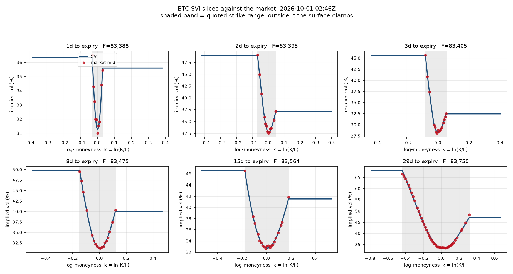
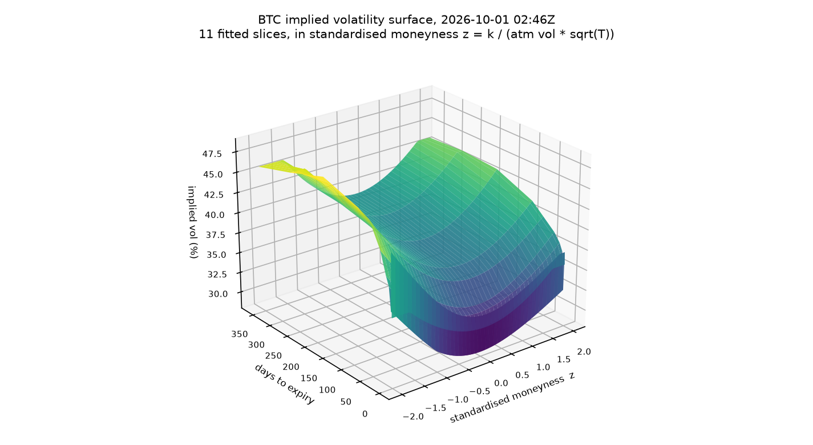

# BTC Implied Volatility Surface + Vol Strategy

An arbitrage-free implied volatility surface built from live Deribit options
data, and a delta-hedged short-straddle strategy backtested on top of it over
six years of archive and three weeks of live hourly chains.

The headline result is negative, and that is the result: **the volatility risk
premium on BTC clears the option bid-ask and then dies on the hedge.** What
decides the outcome is not the premium but how often you rebalance, which is
why most of the measurement here is aimed at hedging cost rather than at
signal.

`BUILD_GUIDE.md` is the original brief, `PLAN.md` the working plan,
`HANDOFF.md` the full state of play and findings, `VIOLATIONS.md` the
arbitrage log, `HYPOTHESES.md` the pre-registered study of why the premium
shrank.

---

## Pipeline

```
Deribit public API
  │  get_instruments → chain discovery          hourly, Windows scheduled task
  │  ticker          → bid/ask/mark_iv/greeks
  ▼
data/        raw chain snapshots (parquet, one per hour per asset)
  │  clean      mid, spread + zero-bid filters, exact UTC time-to-expiry
  │  forward    Deribit's own per-expiry forward (not index × carry)
  │  to_usd     inverse vs linear contracts priced differently
  ▼
pricing/     Black-76 inversion: Brenner-Subrahmanyam seed → Newton → Brent
  │                                      validated vs Deribit mark_iv: 0.048 vol pts
  ▼
surface/     SVI per expiry → arbitrage checks → VolSurface object
  │  butterfly  g(k) ≥ 0 density test
  │  calendar   total variance non-decreasing in T
  │  wing       b(1+|ρ|) ≤ 4/T
  ▼
strategy/    delta-hedged short straddle, three rebalancing rules
  │  costs     entry spread (measured from the book) + hedge slippage + perp funding
  │  backtest  walk-forward, structurally unable to see forward
  ▼
scripts/     checkpoints, six-year studies, hedging-rule sweep, RND monitor
```

Two data tracks feed this. **Track A** is the live hourly collector (contiguous,
started empty — now ~3 weeks). **Track B** is the Tardis.dev free archive: one
full day of hourly chains per month, 2020–2026, 158 days. Track B is what makes
six-year statistics possible at all; Track A is what makes a realistic
hold-to-expiry cost measurement possible.

---

## Surface snapshots

SVI slices against the market's own quotes. The shaded band is the quoted
strike range — outside it the surface clamps, so the flat wings are a boundary
value and not a fit. Note the 1-day slice: very few quotes survive cleaning,
which turns out to matter a great deal (see *What broke*, #2).



The same surface in standardised moneyness `z = k / (σ_ATM √T)`, which is the
coordinate that makes slices of different maturity comparable — in raw
log-moneyness the 1-day slice's ±0.03 quoted range collapses the picture.



Regenerate with `python scripts/make_figures.py`.

---

## Results, honestly

**The premium exists gross, and costs eat it.** Measured on 314 one-day
positions across six years (`archive_study.py`), and on a 128-cell sweep of
rebalancing rules against measured spreads (`hedge_frequency.py`):

| | gross | t | after costs |
|---|---|---|---|
| All inceptions, 2020–26 | +3.8 bps | 0.8 | deeply negative — round-trip pays the spread twice |
| 2021–22 only | +42.9 bps | 4.8 | ≈ flat |
| 2023–26 only | −7.0 bps | −1.8 | negative |

So pooled over six years the **one-day** trade has no premium even *before*
costs. It was capturable in 2021–22 and has not been since.

That is a statement about one-day positions, not about the premium. At 30 days
it is still there in 2023–26 — +4.4 vol points on DVOL against hourly realised
(95% block bootstrap [+2.1, +6.5]), and +83 bps gross on the ATM straddle
(t 2.4), which is about the top of the 31–86 bps cost range. What went away is
the margin over cost, not the premium (`HYPOTHESES.md`).

**Held to expiry, paying the spread once, the picture is better but still
marginal.** BTC 30-day ATM straddle, spread measured per strike from the
archive's own book:

| | net bps of spot | t | n |
|---|---|---|---|
| Premium less option spread only | +73 | 2.4 | 44 |
| Best fixed clock (4–6h), 5 bps slippage | +33 | 0.9 | 44 |
| Whalley-Wilmott band, γ chosen in hindsight | +43 | 1.2 | 44 |
| Whalley-Wilmott band, γ **walked forward** | +59 to +75 | 1.4–2.1 | 65–70 |

**Sharpe and drawdown, with the caveat that matters more than the number.**
For the in-sample band cell above (BTC 30-day ATM, 5 bps, 2023–26, n=44):
Sharpe **0.63**, max drawdown **−624 bps of spot**, hit rate 61%, worst
inception −564 bps, best +598.

That Sharpe is not a number anyone should size on, for three reasons. The
standard deviation is 237 bps against a mean of 43 — the mean is a rounding
error on the dispersion. The inceptions are monthly and *overlapping*, so they
are not independent draws. And n=44 at roughly 12 inceptions a year means the
annualisation factor is doing more work than the data. `compute_metrics` says
as much in its own docstring.

**The largest effect found is not the premium at all.** It is BTC/ETH
dispersion. ETH's 30-day implied trades **+12.9 vol points** over BTC's in the
long run, but relative to what each then realises ETH vol is *cheap* — implied
ratio 1.244 against a realised 1.327. Selling that spread (short ETH vol / long
BTC vol at equal vega) loses **−3.65 vol points a month, t −2.75**, so the
reverse trade earns it; conditioned on the spread being narrow by its own
expanding median — no lookahead — the loss widens to **−6.14, t −4.56**. That
holds in both eras separately and in 6 of 7 years. Larger and more significant
than anything in the straddle results, and the least examined thing here.

---

## What broke, and how it was found

The brief says this log is worth more than the Sharpe number. It is.

**1. A spread filter that measured premium size, not liquidity.** The guide
proposes dropping quotes wider than 15% of mid. Measured on a live chain that
filter passes 96% of ITM quotes and 68% of OTM ones — because cheap options
have wide relative spreads *because they are cheap*. Of the 132 OTM quotes it
rejected, 73 were within two ticks of the exchange minimum, about as tight as
the market is allowed to be. Fixed by passing a quote if it is inside 15% of
mid **or** within two ticks of the exchange minimum. You cannot ask a market to
be tighter than its tick.

**2. The same filter silently froze a live hedge — found by a number that was
too small.** A 4-hour clock on a 24-hour position should rebalance about five
times. It averaged **0.6**. Tracing one position: the straddle's strike
vanished from the chain after six hours, because an ordinary two-sided ATM
quote (bid 0.0024 / ask 0.0028) is 15.4% wide and four ticks, so both rules
rejected it. A position that cannot be priced is never stepped, so the hedge
sat frozen at its last value for 17 of its 24 hours. Repairing it moved
measured hedge slippage from 1.3 to 6.8 bps — the study had been reporting the
cost of a hedge that had largely stopped running.

**3. The guard that should have caught #2 was measuring the wrong thing.**
`max_gap_h` took gaps between *snapshots on disk* rather than between the steps
the position was actually marked at. It reported a 3.0-hour maximum gap on a
position that went 18 hours unhedged, and then marked it `hedged_properly`.
Arguably worse than the bug: the bug was invisible *because* the diagnostic
measured availability instead of the thing it claimed to measure. Gaps are now
measured between marked steps.

**4. The same blindness stops the archive seeing its own front expiries.**
Adding a 1-day tenor to the hedging sweep returned 90,432 rows and zero usable
ones. Not missing data — every archive day carries a 0.33d expiry with 270–810
raw quotes — but after cleaning, that expiry keeps 0 of them, 1.33d keeps 1,
2.33d keeps 5, and SVI refuses anything under 8 points. The shortest *fitted*
slice is 6.33d at the median and exceeds 1 day on 100% of asset-days. Recorded
as a known limitation rather than fixed, because fixing it in the archive fit
would re-derive three sections of published results to answer a question this
project does not need answered.

**5. A cache that would have inflated every t-statistic by √2.** The sweep
shards across workers; globbed together, a cache holding shards from two
different runs counts every day twice. The means barely move and the
t-statistics inflate by about √2 — the most dangerous kind of bug, because the
output still looks reasonable. Both loaders now refuse a mixed cache rather
than averaging it.

**6. A "7-day" hold that silently opened days late.** Deribit lists daily
expiries only a few days ahead, so a 7-day hold of a Monday daily opened
whenever the instrument first appeared, while still being reported as 168
hours. The position must now open at the entry snapshot itself or be skipped.

---

## Interview talking points

*The four the build guide says to prepare.*

**What arbitrage violation did you find, and how did you fix it?** Among quoted
strikes, none — which is the honest answer and the one worth being able to
defend. The violations are all in the extrapolated wings: butterfly violations
reaching an implied density of −0.062 at k=−1.24, and calendar violations where
total variance *falls* by 0.54 between the 10-day and 17-day slices at k=−1.50.
Both are artifacts of asking SVI for a price 1.5 log-moneyness units outside
anything quoted. The fix was to stop pretending: the surface clamps at the
quoted boundary and reports `is_extrapolated`, so a caller marking a position
knows when the number came from a fit and when it came from a boundary. A wing
model would be the real answer; clamping is the honest interim one. Full log in
`VIOLATIONS.md`.

**Why total-variance interpolation instead of IV interpolation?** Because the
no-arbitrage condition in the time direction is monotonicity of *total
variance* w = σ²T, not of σ. Interpolating IV between expiries can produce a
calendar arbitrage even when both endpoint slices are individually fine.
Interpolating w in T and checking it is non-decreasing makes the surface
arbitrage-free in the calendar direction by construction rather than by
inspection.

**What's the strategy's actual source of P&L — decompose it.** For a
delta-hedged short straddle, P&L ≈ ½ · vega-notional · (σ²_implied −
σ²_realised). Everything else is cost. The decomposition is reported per
position — option P&L, hedge P&L, entry spread, hedge slippage, perp funding —
and checked against that theoretical estimate; if realised P&L does not track
it, the hedging or cost logic is wrong and any Sharpe is meaningless. The
measured answer: gross edge of about +83 bps a month, option spread ~11 bps,
and hedge slippage anywhere from 20 to 75 bps depending entirely on the
rebalancing rule. **The hedge, not the premium, is the whole game.**

**What would break this in a real market?** This one has an empirical answer
rather than a hypothetical one, which is the most useful thing in the project.
A liquidity filter calibrated on premium size went blind to short-dated options
and silently froze a live hedge for 17 of 24 hours, while the diagnostic meant
to catch it reported a 3-hour gap. Nothing errored. The lesson generalises past
this bug: the dangerous failures are the ones that produce plausible numbers,
so the guards have to measure the thing they claim to measure, not a proxy that
correlates with it on good days. Beyond that — the premium cleared costs
comfortably in 2021–22 and has shrunk to roughly their size since, so a regime
change already broke the trade once within the sample.

---

## Status

| Stage | State | Checkpoint |
|---|---|---|
| Data pipeline | done | `verify_data.py` — 34/34 |
| Black-76 inversion | done | `verify_pricing.py` — matches Deribit `mark_iv` to 0.048 vol pts |
| SVI calibration | done | `fit_surface.py` — 10/10 slices, 0.165 vol pts median |
| Arbitrage validation | done | `check_arbitrage.py` — none among quoted strikes |
| Surface object | done | `verify_surface.py` — 10/10 |
| Greeks | done | delta matches Deribit to 0.0007 median |
| Strategy + backtest | done | 314 positions, six years |
| Costs + hedging rule | done | 128-cell sweep, walked forward |
| Write-up | **this file** | — |
| Dashboard | not started | `dashboard/app.py` is a stub |

**426 tests.** `python -m pytest`

## Running it

```bash
pip install -r requirements.txt

python scripts/verify_data.py        # Phase 1 checkpoint, 34 checks
python scripts/verify_pricing.py     # Phase 2
python scripts/fit_surface.py        # Phase 3: fit SVI, report smoothness
python scripts/check_arbitrage.py    # Phase 4 (--log appends to VIOLATIONS.md)
python scripts/verify_surface.py     # Phase 5

python scripts/archive_study.py      # 79 one-day positions, six years
python scripts/hedge_frequency.py run          # rebalancing rule vs cost [~5 min]
python scripts/hedge_frequency.py walkforward  # the same, chosen blind
python scripts/hold_to_expiry.py     # live book, settled at expiry
python scripts/rnd_monitor.py        # risk-neutral density
python scripts/vrp_hypotheses.py     # why the premium shrank [~25 s]
python scripts/make_figures.py       # regenerate the snapshots above
```

A clone gets the code and nothing else — every data directory is gitignored.
`HANDOFF.md` §2 says what has to be moved separately.

## Known limitations

The short ones; `HANDOFF.md` §5 has the full list with measurements.

- **No demonstrated edge.** See *Results* — the honest summary is that the
  surviving premium is about the size of realistic costs.
- **The statistics are thin and multiple.** ~12 inceptions a year, overlapping
  monthly positions, BTC and ETH on the same day are not independent, and ~200
  reported cells mean a couple of |t| > 2 are expected by chance.
- **The cleaner is blind to the short end** (see *What broke* #2 and #4). Fixed
  where it broke a live measurement, recorded as a limitation elsewhere.
- **The surface clamps rather than extrapolates** beyond the quoted range.
- **The RND monitor's tail probabilities move with its own integration error** —
  P(below 60k) correlates +0.85 with the density's total mass.
- **The dashboard is not built.**
