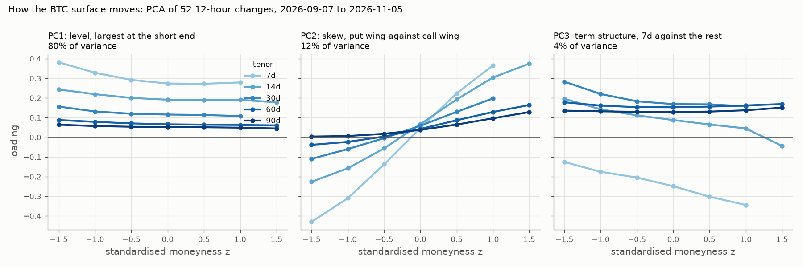

# How does the surface move? PCA on the live surfaces, written before testing

Track A now holds two months of hourly chains (2026-09-07 to 11-04). This
asks what the fitted surface's day-to-day changes are made of: how many
independent ways it moves, what they look like, and whether they are stable
enough to build on. HANDOFF.md calls this the precursor to anything
model-shaped. Expectations are written here **before the code runs**; the
results are appended below them.

Code: `scripts/surface_pca.py`.

## Setup, fixed in advance

- **Snapshots.** Two a day per asset, the ones nearest 08:00 and 20:00 UTC
  (a fit takes ~10 s, so all ~1,550 would take hours). Skip a slot with no
  snapshot within 2 hours of it.
- **Grid.** Tenors 7, 14, 30, 60, 90 days; standardised moneyness
  z = k / (ATM vol × sqrt(T)) at -1.5, -1, -0.5, 0, +0.5, +1, +1.5, where ATM
  vol is the surface's own at that tenor. 35 cells. Implied vol in vol
  points, read off the `VolSurface` the strategy uses.
- **Extrapolation.** A cell is dropped from the PCA if it falls outside the
  supported strike range on more than 10% of snapshots.
- **Changes.** PCA on the covariance of changes between consecutive slots
  (12h apart; a change spanning a missing slot is dropped). Main results on
  the 12h changes; daily (08:00 to 08:00) changes as a robustness check.
- **Stability.** Loadings estimated separately on the first and second half
  of the sample, compared by absolute cosine similarity.

## Expectations

These come from what equity-index and FX surfaces are known to do, plus
what this project has already seen of BTC.

**E1. One factor dominates.** PC1 explains more than 70% of the variance of
changes. It is a level shift: every loading has the same sign.

**E2. PC1 is largest at the short end.** Short-dated vol moves more than
long-dated vol, so PC1's loadings fall with tenor; the 7-day ATM loading is
at least 1.5x the 90-day ATM loading.

**E3. PC2 is the term-structure slope**: short and long tenors load with
opposite signs. **PC3 is skew**: the loadings at z < 0 and z > 0 have
opposite signs within a tenor.

**E4. Three factors suffice.** PC1-3 together explain more than 90%.

**E5. The factors are stable.** First-half and second-half loadings have
|cosine| above 0.9 for PC1 and above 0.7 for PC2.

**E6. Spot and vol move against each other.** PC1 scores correlate
negatively with the spot log return over the same 12h. (The archive shows
a put-over-call skew on average, +4.2 vol points at z = ±1, which is the
equity-like pattern.)

**E7. BTC and ETH share the structure.** Same shape on both: PC1 a level
shift, PC1 cosine between the two assets above 0.9.

## Known issues, stated up front

- About 115 changes per asset on 35 correlated cells. The top one or two
  components are well determined at that size; past PC3 the loadings are
  mostly noise, and they are not interpreted.
- The surface is a fit, so some movement is fitting noise rather than
  market. That shows up as a long tail of small components, and it could
  inflate the short end, where few quotes survive cleaning (README, *What
  broke* #2).
- Two months is one regime. Stability within it says nothing about the next.

---

# Results

Run: `python scripts/surface_pca.py` (165 fits on 6 workers, a few minutes;
cached after that). Figure: `python scripts/make_figures.py pca`. The
expectations above were committed (`0d37de1`) before this code existed and
are unedited.

**Sample, smaller than planned.** Laptop sleep leaves holes, and a change
needs both ends of a 12h pair: BTC has 83 slots and **52 changes**, ETH 82
and **51**. Two cells (7d and 30d at z = +1.5) were extrapolated too often
and dropped, plus 30d z = -1.5 on ETH. Over the sample BTC 30d ATM sat at
32-39 (mean 35.7), ETH at 45-54: one quiet regime.

## Verdicts

| | Expectation | BTC | ETH | Verdict |
|---|---|---|---|---|
| E1 | PC1 > 70%, one sign | 80.1%, one sign | 89.2%, one sign | **Holds** |
| E2 | PC1 7d/90d ATM ≥ 1.5 | 5.3 | 6.7 | **Holds, much more strongly** |
| E3 | PC2 term slope, PC3 skew | PC2 skew, PC3 term | same | **Fails on order**: both shapes are there, swapped |
| E4 | PC1-3 > 90% | 96.2% | 97.4% | **Holds** |
| E5 | halves: PC1 > 0.9, PC2 > 0.7 | 0.92, 0.76 | 0.98, 0.92 | **Holds** (n = 26 a half) |
| E6 | PC1 against spot | **+0.32** | -0.23 | **Fails**: BTC vol rose *with* spot; ETH not significant |
| E7 | BTC/ETH PC1 cos > 0.9 | — | 1.00 (PC2 0.93, PC3 0.89) | **Holds** |

## What the data says

- **One factor is most of it, and it lives at the short end.** PC1 moves
  every cell the same way, but 7-day vol moves 5-7 times as much as 90-day.
  The 12h standard deviation of ATM vol falls from 1.73 vol points at 7d to
  0.41 at 90d on BTC (2.51 to 0.41 on ETH). The put wing loads a little more
  than ATM at every tenor.
- **The second factor is skew, not slope.** PC2 (12% BTC, 6% ETH) tilts the
  smile: put wing one way, call wing the other, again mostly at the short
  end. The term-structure factor is PC3 (4%, 2%): 7d against everything
  else. In equity indices the term slope usually comes second; here skew
  does. With 52 changes the PC2/PC3 order is the least certain thing in this
  table, but both halves agree on PC2's shape (0.76 BTC, 0.92 ETH).
- **Skew moves with spot, strongly.** PC2 scores correlate +0.36 (BTC) and
  **+0.64** (ETH) with the 12h spot return: when spot rises the call wing
  gains on the put wing. That is the clearest spot-vol link here.
- **The level moved with spot on BTC (+0.32, about 2 s.e.).** That is the
  opposite of the equity pattern E6 assumed, and against the put-over-call
  skew the archive shows on average. It is one quiet, two-month regime; ETH
  shows the equity sign (-0.23) but not significantly. Treat the BTC sign as
  a property of these weeks, not of BTC.
- **BTC and ETH move the same way.** PC1 cosine 1.00, PC2 0.93, PC3 0.89 on
  the 32 shared cells. One set of factors describes both surfaces.
- **The daily check agrees.** On 08:00-to-08:00 changes (n = 17 BTC, 16 ETH)
  PC1 is 77% / 86%, PC1-3 97%, and PC1 and PC2 match the 12h loadings at
  cosine 0.93-0.98.

## Caveats that bite

- **The grid moves with spot.** z is measured from the forward, so a cell
  is a different strike after spot moves. Under a sticky-strike smile that
  alone moves the fixed-z vol with spot, so the spot correlations above mix
  the market's own response with re-indexing along a skewed smile. Fixed-
  strike changes would separate the two; not done.
- **Some of the short end is fitting noise.** The 7d slice is fitted
  through few surviving quotes, and its 12h moves are the largest on the
  grid. PC1's steep fall with tenor is far too large to be noise alone (5x),
  but PC3, which is mostly "7d against the rest", could partly be.
- **52 changes is small.** PC1 and PC2 are well determined (stable across
  halves); PC3 is borderline (0.70 BTC, 0.69 ETH); nothing past it is
  interpreted.

## What it means for the rest of the project

- **A three-factor surface is enough** for anything here: 96-97% of changes,
  and the same factors on both assets. A model of the surface needs level,
  skew and a short-end term factor, in that order.
- **Vega across tenors is not one number.** A 7-day vega point moves five
  times as much as a 90-day one under the same factor, so any book that nets
  vega across tenors should weight it by PC1 loading, not add raw vega. The
  dispersion trade (HANDOFF §7) is same-tenor, and PC1's cosine of 1.00
  between BTC and ETH is the good news for it: the two surfaces share their
  main factor, so a vega-matched pair is close to factor-neutral.
- **The next sample will be bigger for free**, and it needs a collector
  that does not sleep: half the possible 12h pairs were lost to gaps.

---

# Rerun through the sell-off, written before testing (2026-11-15)

The first sample ended on 2026-11-05 at 20:00 UTC, one quiet regime. Since
then BTC has fallen from about 76k to 64k, and ETH from about 2,450 to
1,830. The 24h realised vol of BTC passed 100% (`INVERSE_LINEAR.md`). Every
change after that cutoff is new data that the original loadings have never
seen. So the first question is whether factors fitted on a quiet regime
describe a crash. The second is whether the BTC level/spot sign, flagged
above as "a property of these weeks", flips.

**Setup, same as above:** same grid, same slots, same cached fits, and only
the new snapshots get fitted. Call the original sample *in-sample* (slots up
to 2026-11-05 20:00) and everything after it *new*.

**Measure.** *Out-of-sample share* is the fraction of the new changes'
demeaned sum of squares captured by projecting onto the in-sample top-3
loadings. Since there are only about a dozen new 12h changes per asset,
loadings are not refitted on the new period alone.

**R1. The old factors describe the crash.** The out-of-sample share of
in-sample PC1-3 is above 85% on both assets. The in-sample PC1 alone takes
above 65%.

**R2. The crash is mostly a level move.** On new changes, the variance of
the PC1 score is at least 3× its in-sample variance: a far larger level
move, not a different kind of move.

**R3. In a sell-off, level moves against spot.** On the new changes, the
in-sample PC1 score correlates negatively with the 12h spot return on both
assets. That is the equity sign E6 expected, and it should show up once
spot is falling hard.

**R4. Skew keeps moving with spot.** The PC2 score still correlates
positively with the 12h spot return on the new changes (both assets).

**R5. The full sample keeps the structure.** Refitted on all changes, PC1
is above 70% with one sign, PC1-3 is above 90%, and the cosine between the
full and in-sample PC1 is above 0.9.

**Known weakness.** About a dozen new changes per asset. Correlations on
n ≈ 12 have a two-standard-error band of about ±0.6, so R3 and R4 can only
fail loudly or pass weakly. R1 and R2 are about variance shares and are
better determined.
